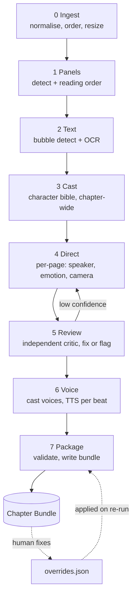

# 02 - Design: MangaPlay

Status: **decisions locked in `00-DECISIONS.md`** (English only, user uploads, personal use, CPU only, local TTS first, vertical-scroll webtoons, stack approved). Where this document still says "page" or "panel" in a general sense, read it through section 4b: for webtoons the unit is a continuous **strip** divided into **segments**.

## 1. Product in one paragraph

A web manga reader that can **play itself**: it moves a virtual camera panel by panel (or scrolls continuously), and **reads each speech bubble aloud with a fitting voice and emotion**, highlighting the bubble as it speaks - like watching the anime, but the art stays the original manga. The user can pause, seek, change speed, switch to plain manual reading, and fix mistakes.

## 2. Two systems, one contract

```
+---------------------------- AUTHORING (offline, agentic) -----------------------------+
|  Claude Code skills + subagents + deterministic Python tools                           |
|  pages in  -->  panels, bubbles, speakers, emotions, voices, audio  -->  Chapter Bundle |
+-----------------------------------------------+----------------------------------------+
                                                |  chapter bundle (static files)
                                                v
+------------------------------- READER (web app) -------------------------------------+
|  loads bundle, plays timeline: camera + audio + highlights; correction editor          |
+-----------------------------------------------------------------------------------------+
```

The **Chapter Bundle** is the only contract between them. Consequences: the reader needs no AI at runtime (cheap, fast, offline-capable); the pipeline can be rewritten or re-run without touching the app; bundles are plain static files.

Why not run Claude live in the reader? Latency (seconds per page), cost per read, and non-determinism during playback. Pre-computing once per chapter is better on all three. Claude Code is the *authoring* orchestrator; it is a CLI and is not meant to be the runtime for end users.

## 3. Chapter Bundle

```
bundles/<series>/<chapter>/
  manifest.json        # id, title, language, reading_direction (rtl|ltr|vertical), page count, schema_version, pipeline run id
  pages/001.webp ...   # original page images, resized for web
  script.json          # the performance script (section 4)
  cast.json            # characters, descriptions, voice assignments
  overrides.json       # human corrections; survive pipeline re-runs
  audio/<beat-id>.opus # one clip per spoken beat
  _run/                # pipeline working files: run config, metrics.json, per-stage outputs, reviewer notes
```

## 4. The performance script (`script.json`)

Hierarchy: chapter -> page -> panel -> **beat**. A beat is anything with a time dimension: a spoken line, a thought, narration, an SFX cue.

```jsonc
{
  "schema_version": 1,
  "reading_direction": "rtl",
  "pages": [{
    "index": 1,
    "image": "pages/001.webp",
    "size": [1600, 2400],
    "panels": [{
      "id": "p001-02",
      "order": 2,
      "bbox": [120, 610, 700, 540],          // x, y, w, h in page pixels
      "scene": "Close-up, Aiko gripping the railing, wind in her hair",   // alt text + reviewer context
      "shot": "close_up",
      "camera": { "move": "push_in", "focus": [260, 700, 400, 380] },
      "hold_ms": 600,                         // minimum extra dwell after last beat
      "beats": [{
        "id": "p001-02-b1",
        "type": "speech",                     // speech | thought | narration | sfx
        "bbox": [180, 640, 210, 120],         // bubble location, for highlight
        "text": "I won't run anymore.",
        "speaker": "c1",                      // cast id | "narrator" | "unknown"
        "emotion": "resolute",
        "delivery": "quiet, firm",
        "confidence": 0.78,                   // min over order / text / speaker
        "needs_review": false,
        "audio": "audio/p001-02-b1.opus",
        "audio_ms": 1900
      }]
    }]
  }]
}
```

Rules, each one learned from the reference's pain points (analysis section 4):
- **Text is never embedded in prose.** `scene` describes visuals only; spoken text lives only in `beats[].text`.
- **Bbox on the original page**, not cropped images. The camera pans/zooms over the real page, so nothing is lost and corrections are a drag handle.
- **Every item carries `confidence`.** Low confidence or reviewer disagreement sets `needs_review`.
- Types and enums are defined **once** (Pydantic) and exported as JSON Schema -> TypeScript types. The pipeline and the app cannot drift.
- Playback **timeline is derived at runtime** from beats + `audio_ms` + `hold_ms`, not stored. Changing speed or voice never invalidates the script.

## 4b. Webtoon variant of the script (the v1 format)

A webtoon episode is one tall image, usually delivered as many slices. We stitch the slices into a **virtual strip** (keep slice boundaries in the manifest, do not re-encode into one giant file) and use strip coordinates everywhere.

```jsonc
{
  "schema_version": 1,
  "strip": { "width": 800, "height": 14200, "slices": [{ "file": "strip/001.webp", "y": 0, "h": 1280 }] },
  "segments": [{                              // gutter-separated scenes; replaces "panel"
    "id": "s012", "y": 5200, "h": 900,
    "scene": "Aiko on the rooftop, sunset, looking down",
    "beats": [{
      "id": "s012-b1",
      "type": "speech",                       // speech | thought | narration | sfx
      "bbox": [120, 5330, 260, 110],          // strip pixels
      "text": "I won't run anymore.",
      "speaker": "c1", "emotion": "resolute", "delivery": "quiet, firm",
      "confidence": 0.78, "needs_review": false,
      "audio": "audio/s012-b1.opus", "audio_ms": 1900
    }]
  }]
}
```

Differences from the page-based sketch in section 4:
- **No reading order problem**: order is top to bottom, left to right within a row of bubbles. Bubble order inside a segment is the only ordering the Director and Reviewer must confirm.
- **Auto-scroll is derived from bubble positions.** The scroll target for a beat is `bbox.y` placed at about 40% of viewport height; between beats the scroll eases from one target to the next over the audio duration. Silent segments scroll at a speed derived from segment height (the reference's `1s + area share` heuristic, adapted to height).
- `segments` are optional metadata for scene summaries, alt text and chunking work for the LLM; playback only needs `beats`.
- Page-based `pages/panels` stays in the schema as a second variant (`layout: "pages"`) for later, not built in v1.

## 5. Authoring pipeline



| Stage | Done by | Notes |
|---|---|---|
| 0 Ingest | Python tool | Accepts folder / zip / cbz / one long image. Natural-sort slices, stitch virtually, record slice offsets, webp output. |
| 1 Segments | Python tool (image processing, no ML) | Find horizontal gutters (rows of near-uniform colour) to split the strip into segments. Work in overlapping windows for memory. Overlay render for eyeballing. |
| 2 Text | Python tool: **fuse** ONNX OCR text blocks + bubble-detector boxes (measured in `05-DETECTION-SPIKE.md`) | OCR gives text + position; detector gives bubble outline, bubble-vs-free-text, and punctuation-only reactions. Deterministic repairs: word-spacing (wordninja with name protection), credit filter. Output is a list of draft beats with `needs_review` flags for the Director to verify against the image. English only. |
| 3 Cast | **LLM** (Claude, vision) | Reads the whole chapter's pages at low res to name/describe recurring characters, produces `cast.json`. Output stays stable across pages so later calls reference ids. |
| 4 Direct | **LLM** subagent per page, parallel | Inputs: page image, panel+bubble boxes, OCR text, cast bible, previous page's last 2 beats (continuity). Outputs: speaker, bubble type, emotion, delivery, scene, camera hint. Image beats OCR text where they disagree (reference rule 1). |
| 5 Review | **LLM** subagent, separate from Direct | Checks speaker attribution, order, missed or invented bubbles against the image. Fixes clear errors, flags the rest. Only `needs_review` panels get a second Direct candidate (best-of-N, confidence-gated, not blanket). |
| 6 Voice | Python tool + TTS provider | Maps cast -> voice once per series, then synthesises each beat with emotion/delivery. Cached by hash of (text, voice, delivery, provider) so re-runs are free. |
| 7 Package | Python tool | Validates against JSON Schema, applies `overrides.json`, writes bundle, writes `metrics.json`. |

Engineering rules carried over from the reference: every stage is **idempotent with a `done` check on its output files**, runs go in timestamped folders with a config snapshot, `metrics.json` records wall time, LLM calls, TTS characters, retries and failures, and a stage that "completes" with missing outputs is an error.

Rules fixed from the reference's weaknesses: schema-validated LLM output with bounded retry; failures raise and are recorded per item rather than silently becoming `None`; explicit config object, not env-var side channels; page is the unit of work (a chapter is hundreds of panels).

### Failure model
A bad page must not sink a chapter. Per-page status (`ok | flagged | failed`) is stored; the chapter packages with failed pages falling back to **plain manual reading** (no audio, no auto-scroll) and a visible marker in the editor.

## 6. Claude Code layout (the "agentic system")

Skills hold instructions and call deterministic tools; subagents give fresh context and independence.

```
.claude/
  skills/
    manga-chapter/      # orchestrator: runs stages 0-7 for one chapter, resumable, reports status
    manga-panels/       # stage 1-2: runs tools, sanity-checks counts and order, renders overlay PNGs to eyeball
    manga-cast/         # stage 3
    manga-direct/       # stage 4: the rubric and schema the director follows
    manga-review/       # stage 5: the reviewer's rubric (speaker, order, missing/invented bubbles)
    manga-voice/        # stage 6: voice casting rules, provider config
    manga-package/      # stage 7
  agents/
    page-director.md    # sees one page + context, returns schema-valid beats
    page-reviewer.md    # different prompt, never sees the director's reasoning, only its output
tools/                  # Python (typed, tested): ingest, panels, ocr, tts, package, validate
```

Design decisions:
- **LLM only where judgement is needed** (cast, speaker, emotion, camera, review). Detection, OCR, TTS, packaging, validation are deterministic tools - testable and cheap to re-run.
- **One subagent per page, fanned out in batches.** Bounded context, parallel, and a failed page is isolated.
- **Reviewer is a separate agent with its own rubric**, mirroring the reference's creator/reviewer split. It receives the page image and the director's JSON, not the director's chain of thought.
- **Overlay renders** (boxes + order numbers drawn on the page) are produced after stages 1-2 so Claude and the human can both verify detection visually before any tokens are spent on directing.
- Later option: port the same skills to the Claude Agent SDK for server-triggered processing. The tool layer and schema do not change.

## 7. Reader application

### 7.1 Modes
1. **Auto-scroll read-along** (primary, v1): the strip scrolls so the current bubble sits in the reading zone, the bubble is highlighted, its audio plays, then the scroll eases to the next. Silent stretches scroll at a height-based pace.
2. **Manual**: normal free scrolling; tap any bubble to hear it; tapping resumes auto-scroll from there. Scrolling by hand during auto mode pauses it and re-syncs to the nearest beat.
3. **Cinematic zoom** (later): segment-by-segment focus with zoom, more anime-like than scroll. Deferred; the engine already supports it because the camera is just a function of the cursor.
Each mode shares one playback engine; they only differ in how the camera is driven.

### 7.2 Playback engine
- State: `chapter`, `cursor (page, panel, beat)`, `status (idle|playing|paused|seeking)`, `rate`, `mode`.
- **Audio is the clock.** Web Audio API schedules beat clips; camera moves are timed to the beat durations, never the other way round, so voice and visuals can't drift.
- Panel dwell = `max(sum(audio_ms of beats) + gaps, visual_min)`, where `visual_min` starts from the reference's heuristic (`1s + area_ratio*10s`, clamped) for silent panels.
- Prefetch next 2 pages' images and next ~10 beats' audio.
- Controls: play/pause, next/prev panel, next/prev page, scrub, speed (0.75-2x with pitch-preserving rate), voice mode (cast / narrator-only / off), captions on/off, reduce-motion (cuts instead of pans), keyboard + touch + gamepad-free.

### 7.3 Director's desk (correction editor)
Same app, edit mode. Overlay shows panel boxes with order numbers and bubble boxes. Actions: drag/resize boxes, reorder panels, reassign speaker, edit text, change emotion, preview voice, re-synthesise one beat. Edits write `overrides.json` keyed by stable ids, so **pipeline re-runs never destroy human work**. `needs_review` items are queued first. This is what turns a ~90%-accurate pipeline into a product people trust.

### 7.4 Accessibility and UX floor
Captions mirror speech; prefers-reduced-motion respected; screen-reader alt text from `scene`; all controls keyboard-operable; no autoplay with sound until a user gesture (browser rule anyway).

## 8. Voice and "anime feel"

Tiers so we can ship early and improve:
1. **Narrator mode** - one good voice reads everything. Baseline, proves the timeline.
2. **Cast mode** - distinct voice per character, chosen by cast attributes (age, gender, personality) once per series and remembered.
3. **Performance mode** - emotion/delivery per beat (provider style tags or instructions), SFX cues from a small licensed sample library, optional light background ambience.
Provider interface (`synthesize(text, voice, delivery) -> audio`) has several implementations behind a registry (pattern borrowed from the reference's `Backend` classes). **v1 ships with local CPU providers only (D4, D5)**; the interface exists from day one so a paid provider is a drop-in. Candidates and what to measure are in `04-TTS-CANDIDATES.md`; the leading candidate is Kokoro via ONNX on CPU, with Piper as a lighter fallback. On local voices expect tier 2 (distinct voices) to be strong and tier 3 (acted emotion) to be modest: emotion is approximated through voice choice, speaking rate, and punctuation. Paid providers with real style control are the upgrade path for tier 3. Quality, pricing and licence terms change quickly and must be checked at upgrade time.

## 9. Technology stack - recommendation (to confirm)

Principle: the reader is a **client-side player over static files**. The MVP needs **no server and no database**.

| Layer | Recommendation | Why | Alternatives |
|---|---|---|---|
| Reader UI | **TypeScript + React + Vite**, PWA | Pure SPA is enough; no SSR need yet; best ecosystem and Claude Code fluency | SvelteKit (lighter, smaller ecosystem); Next.js (only if we need SEO, auth, SSR) |
| Playback | Web Audio API + CSS transforms / Web Animations API; GSAP only if needed | Audio-as-clock needs precise scheduling | Howler.js (simpler, less control) |
| State | Zustand (or XState for the playback state machine) | Playback is a state machine with clear transitions | Redux Toolkit |
| Editor canvas | SVG overlay on the page image | Simple hit-testing and drag handles | Konva/Fabric if it gets heavy |
| Offline | IndexedDB + service worker cache of bundles | Read on a train | - |
| Pipeline tools | **Python 3.11+** managed with `uv` (Windows-native, no bash/conda; 3.11.9 is installed, `uv` can fetch 3.12 if wanted) | Detectors, OCR, Pillow are all Python | - |
| Audio encode | Bundled ffmpeg via the `imageio-ffmpeg` wheel (system ffmpeg is not installed) | No system install needed | `soundfile` OGG/Opus if sufficient |
| Detector runtime | ONNX Runtime (CPU) | Avoids a PyTorch install and Ultralytics' AGPL runtime | Ultralytics for the spike only |
| Schema | **Pydantic -> JSON Schema -> TS types** | One source of truth for pipeline and app | Zod + generate Python |
| TTS | Provider registry, decided by Phase 0 spike | See section 8 | - |
| Storage (MVP) | Local `bundles/` served statically | No infra | - |
| Storage (later) | Object storage (S3/R2-style) + CDN for bundles | Static, cacheable | - |
| API/DB (later, if multi-user) | FastAPI + SQLite->Postgres for library, progress, accounts | Only when needed | Supabase/Firebase |
| Tests | Vitest + Playwright (app), pytest (tools), schema-validation of golden bundles | | |

## 10. Risks (ranked)

1. **Speaker attribution accuracy.** The reference authors made it a dedicated criterion. Mitigation: vision LLM + independent reviewer + confidence flags + the editor. Measure on a labelled sample in Phase 0.
2. **Panel/bubble detection on odd layouts and RTL ordering.** Mitigation: overlay verification, editor, per-page fallback to manual mode.
3. **Voice quality and cost** - the "real anime" feel lives or dies here. Mitigation: tiered voice modes, cache by content hash, spike before committing.
4. **Webtoon-specific detection.** Full-colour art, text on busy backgrounds, very tall images, bubbles cut by slice or window seams. Mitigation: overlapping windows with cross-seam de-duplication; overlays; editor.
5. **Rights.** User-uploaded commercial webtoons are copyrighted. v1 is a personal local tool (D3): nothing is hosted or shared, and bundles stay on this machine. Revisit before any sharing.
6. **Sync drift** between audio and camera. Mitigation: audio-as-clock architecture.
7. **Model cost drift** across a long chapter. Mitigation: per-stage metrics, per-page batching, confidence-gated second passes only.

## 11. Non-goals for v1
Video generation (the reference's whole second half); in-browser ML; user accounts; social features; translation quality tuning; mobile native apps.
